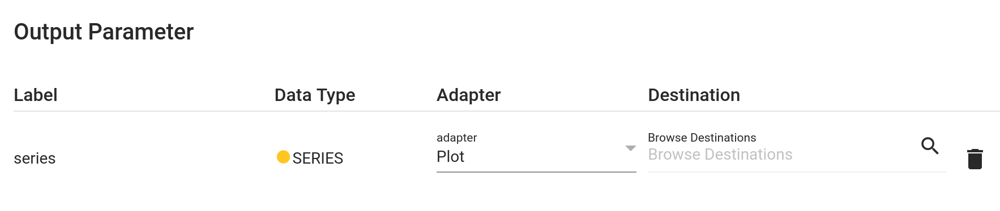

# Plot adapter

The plot adapter can only be wired to outputs and replaces the result with a PLOTLYJSON, using a fixed visualization depending on the output type.

It can be used to get a quick visualization of an output instead of the json object. E.g. for a SERIES output it provides a simple single timeseries plot.

In hetida designer UI this is a quick way to visualize output data when testing components/workflows that are meant for automation, avoiding the need to add a visualization component operator to the workflow.

The visualization depends on the output type:

| Output type | Visualization |
|---|---|
| STRING, INT, FLOAT, BOOLEAN | the value as text |
| SERIES | timeseries plot |
| MULTITSFRAME | timeseries plot with one line and y axis per metric |
| SINGLETSFRAME | timeseries plot with one line and y axis per value column |
| DATAFRAME | line plot of all columns over the column "timestamp" if it has one and this is possible, otherwise a table |
| PLOTLYJSON | the plot itself |
| ANY | depends on the value, see below |

For ANY outputs the visualization is chosen by the value:

* plotly figures and plotly json objects, e.g. the PLOTLYJSON output of a visualization component, are shown as they are
* single values like strings, numbers, booleans or None are shown as text
* Pandas Series like for SERIES outputs
* Pandas DataFrames with the columns "timestamp" (with datetimes), "metric" and "value" of a MULTITSFRAME like for MULTITSFRAME outputs, other DataFrames like for DATAFRAME outputs
* for other values, e.g. lists or other dictionaries, the text "Unplottable ANY object" is shown

The PLOTLYJSON results are returned with the execution response in the same way the original outputs would be returned if *Only Output*, i.e. the [direct provisioning](./direct_provisioning.md) adapter, was selected. The type in `output_types_by_output_name` is set to PLOTLYJSON and the value in `output_results_by_output_name` is the plotly json object.