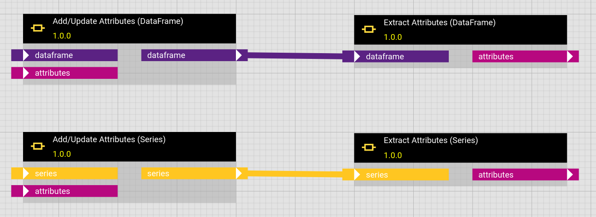

# DataFrames, MultiTSFrames, SingleTSFrames and Series with attached Metadata

Metadata is an essential ingredient for many analytical operations. E.g. if you want to detect gaps in an irregular timeseries and you only get the timestamp, value pairs loaded for a time interval, you cannot know where the interval starts and ends. Consequently you are unable to say whether there is a gap at the beginning or end. The loaded interval boundaries are necessary metadata for the gap detection.

Both [pandas DataFrames](https://pandas.pydata.org/docs/reference/api/pandas.DataFrame.attrs.html) and [pandas Series](https://pandas.pydata.org/docs/reference/api/pandas.Series.attrs.html) can have metadata attached in their attribute `attrs`.

hetida designer and its [adapter system](../integration_guide/adapter_system/adapter_system_introduction.md) support enriching and receiving such metadata. Especially for timeseries data hetida designer propagates conventions described further below and provides helper functions to gather metadata fields.

## Simple, convention-agnostic, metadata access

To extract or update the metadata the corresponding base components "Extract Attributes (DataFrame)", "Extract Attributes (MultiTSFrame)", "Extract Attributes (SingleTSFrame)", "Extract Attributes (Series)", "Add/Update Attributes (DataFrame)", "Add/Update Attributes (MultiTSFrame)", "Add/Update Attributes (SingleTSFrame)" and "Add/Update Attributes (Series)" are available in the category "Connectors".

<figure markdown="span">
{ height="110" width=850}
</figure>

The "Extract Attributes" components read `attrs` from the underlying Dataframe/Series object and output it as a Python dictionary.

The "Add/Update Attributes" components update the metadata dictionary stored in `attrs` of the underlying Dataframe/Series.

Both components do not in any way assume any structure of the metadata dictionary. We recommend to adhere to the conventions described below and use the respective helper functions instead.

## Providing and outputting metadata with manual input (direct provisioning)

You can provide metadata when manual inputting, i.e. using the [direct provisioning adapter](../integration_guide/adapter_system/builtin_adapters/direct_provisioning.md) data by using a wrapped format as follows:

```json
{
  "__hd_wrapped_data_object__": "DATAFRAME",
  "__metadata__": { "test": 43 },
  "__data__": { "a": [2.3, 2.4, 2.5], "b": ["t", "t", "k"] }
}
```

for a DATAFRAME input, whose metadata can be any JSON object, since the metadata conventions do not cover DATAFRAMEs,

```json
{
  "__hd_wrapped_data_object__": "DATAFRAME",
  "__metadata__": {
    "dataset_metadata": {
      "metric_key": "id",
      "queried_metrics": ["a", "b"],
      "ref_interval_start_timestamp": "2023-01-01T00:00:00Z",
      "ref_interval_end_timestamp": "2023-01-02T00:00:00Z",
      "ref_interval_type": "closed"
    },
    "metrics": [
      {
        "id": "a",
        "name": "Temperature",
        "value_dimensions": [{ "column": "value", "unit": "°C", "measurement": "temperature" }]
      },
      {
        "id": "b",
        "name": "Pressure",
        "value_dimensions": [{ "column": "value", "unit": "bar", "measurement": "pressure" }]
      }
    ]
  },
  "__data__": {
    "metric": ["a", "b"],
    "timestamp": ["2023-01-01T00:00:00.000Z", "2023-01-01T00:00:00.000Z"],
    "value": [21.3, 1.2]
  }
}
```

for a MULTITSFRAME input or

```json
{
  "__hd_wrapped_data_object__": "SERIES",
  "__metadata__": {
    "dataset_metadata": {
      "metric_key": "id",
      "single_metric": "a",
      "queried_metrics": ["a"],
      "ref_interval_start_timestamp": "2023-01-01T00:00:00Z",
      "ref_interval_end_timestamp": "2023-01-02T00:00:00Z",
      "ref_interval_type": "closed"
    },
    "metrics": [
      {
        "id": "a",
        "name": "Temperature",
        "value_dimensions": [{ "column": "value", "unit": "°C", "measurement": "temperature" }]
      }
    ]
  },
  "__data__": {
    "2023-01-01T00:00:00.000Z": 21.3,
    "2023-01-01T01:00:00.000Z": 21.7,
    "2023-01-01T02:00:00.000Z": 22.4
  }
}
```

for a SERIES input. The metadata of SERIES, SINGLETSFRAME and MULTITSFRAME inputs should follow the [metadata conventions](#metadata-conventions) as in these examples.

Here the content of the `__data__` field can be anything which the corresponding actual DataFrame or Series parsing may understand. See below for more parsing options!

This "wrapper" format is also received when using the direct provisioning adapter for outputs ("Output Only" in the execution dialog).

!!! info "Unwrapped Format"
    Note that the unwrapped format (i.e. sending only the content of the `__data__` field unwrapped) also works and provides the parsed object with an empty dictionary `{}` as `.attrs` attribute.

!!! info "Mounted Files Adapter"
    The [local file adapter](../integration_guide/adapter_system/builtin_adapters/local_file_adapter.md) does not support sending or receiving metadata in `attrs` currently.

## Metadata conventions

For writing generalizable (base) components, it is preferred to have a metadata structure convention that adapters can conform to in order to make these components work with the data they provide. E.g. a component that plots timeseries data should expect the units at a specific point in the metadata which is independent on which adapter is used.

When writing your own adapters, we therefore strongly advise to follow the conventions defined here. On the other side adapters, when receiving data can make use of metadata to decide how to handle this data, e.g. whether existing data in the target interval should be invalidated / overwritten.

The metadata conventions defined here should be used for timeseries data of type SERIES, SINGLETSFRAME or MULTITSFRAME

### Basic concepts

We differentiate between

- metadata associated to the dataset
    - Examples: Loaded interval boundaries, aggregation level, requested metrics, ... Furthermore when the dataset is sent somewhere: How should it treat existing data, eg. invalidate it / overwrite it, etc.
- metadata associated to the metrics / timeseries
    - Examples: name, location
- metadata associated to individual value dimensions for a multidimensional timeseries
    - A multitsframe typically comes with one column "value" which defines a value dimension of that name for each metric. But multitsframes support arbitrary columns in addition to the fixed `timestamp` and `metric` columns. All these additional columns define a value dimension for each metric.
    - Examples: unit, measurement
    - For example you may have two metrics "pressure" and "temperature" in a multitsframe which only has one value column. You need to know that for the "pressure" metric the unit associated to the value dimension "value" is "bar" and for the "temperature" metric the unit associated to the value dimension "value" is "°C"
- metadata associated to each datapoint (pointwise)
    - Examples: state (valid/invalid), ingestion timestamp

#### Metadata associated to each datapoint

Such metadata should be a dedicated column in a multitsframe and thus is handled as an additional column, defining a value dimension for each metric. We hence consider such point-wise metadata as data.

### General structure of .attrs

The metadata conventions are strict: Metadata adhering to them provides the fields marked as required below. Some of them may be null where the information does not apply, e.g. the unit of a dimensionless quantity. The other fields are optional and can be omitted or null. Additional fields are allowed at every level.

Consumers like components should nevertheless not require metadata and should behave reasonably if it is missing or incomplete, since metadata is only checked where this is [configured](#specification-and-validation).

Described as json:

```yaml
{
  "dataset_metadata": { # required
    # metadata
    # * specific to the dataset (typically the queried interval)
    # * what should happen during saving, in particular invalidation / deletion of existing data

    "metric_key": "id", # required. Which field of the metric objects under "metrics"
    # identifies a metric, i.e. occurs in the metric column of a MULTITSFRAME.

    "single_metric": "abcdef-1234", # required for SERIES and SINGLETSFRAME: the value of the
    # "metric_key" field of the single metric under "metrics". Must not be set (or be null)
    # for a MULTITSFRAME with more than one metric.

    "queried_metrics": ["abcdef-1234"], # required. Since not all queried metrics may have
    # data in the queried interval, a metric may be missing in the data. Therefore it is
    # explicitly listed which metrics were requested.

    ... # see below!
  },
  "metrics": [ # required. Exactly one metric for SERIES and SINGLETSFRAME, all metrics
               # occurring in the data for MULTITSFRAME
    {
      "id": "abcdef-1234", # required
      "name": "Temperature sensor 1", # required
      "value_dimensions": [ # required: an entry for each value column of the data, i.e.
                            # exactly the value dimension "value" for a SERIES
        {
          "column": "value", # required. The actual column name in the data. This connects
          # the value dimension to the actual column.
          "unit": "°C", # required, null for dimensionless quantities or if unknown
          "measurement": "temperature", # required, null if unknown
          ...
        }
      ],
      ...
    },
    ...
  ],
  "value_dimensions_shared": [ # optional
      # metadata of value dimensions that have the same meaning for all metrics. Consumers use
      # it as fallback, but it does not replace the value dimensions of the metrics.
      {
        "column": "state", # required
        "description": "0: valid, 1: invalid",
        ...
      }
      ...
  ]
}
```

Important hints:

- The structure is the same for MULTITSFRAME, SINGLETSFRAME and SERIES. Only the requirements on `single_metric` and on the number of metrics differ.
- The invalidation / overwrite / delete behaviour is defined on the dataset, not on individual metrics or even value dimensions.
- Additional metadata fields can be present at every point in the structure.

#### Example for SERIES

```json
{
  "dataset_metadata": {
    "metric_key": "id",
    "single_metric": "my_series",
    "queried_metrics": ["my_series"],
    "ref_interval_start_timestamp": "2026-01-01T00:00:00+00:00",
    "ref_interval_end_timestamp": "2026-01-02T00:00:00+00:00",
    "ref_interval_type": "closed"
  },
  "metrics": [
    {
      "id": "my_series",
      "name": "My series",
      "value_dimensions": [{ "column": "value", "unit": "kg", "measurement": "mass" }]
    }
  ]
}
```

!!! info "Series => exactly one value dimension"
    A SERIES inherently has exactly one value dimension (1-dimensional timeseries), which is "value". Like for the other data types its metadata is provided under `value_dimensions`.

#### Example for SINGLETSFRAME

A [SINGLETSFRAME](data_types/singletsframes.md) holds exactly one metric — like a SERIES — but arbitrarily many value dimensions — like a MULTITSFRAME. Its metadata therefore combines both: the single metric is named via `dataset_metadata.single_metric`, and its value dimensions are listed under `value_dimensions`.

```yaml
{
  "dataset_metadata": {
    "metric_key": "external_id",
    "single_metric": "abc.temp", # the one metric this frame contains.
                                 # * in contrast to a MULTITSFRAME there is no metric column
                                 #   in the dataframe that it could refer to.
    "queried_metrics": ["abc.temp"],
    "ref_interval_start_timestamp": "2026-01-01T00:00:00+00:00",
    "ref_interval_end_timestamp": "2026-01-02T00:00:00+00:00",
    "ref_interval_type": "closed"
  },
  "metrics": [
    {
      "id": "3f2b1c4d-5e6f-4a7b-8c9d-0e1f2a3b4c5d",
      "external_id": "abc.temp",
      "name": "ABC temperature",
      "value_dimensions": [
        {
          "column": "value", # actual column name in the singletsframe
          "unit": "°C",
          "measurement": "temperature"
        },
        {
          "column": "state", # a second value dimension of the same timeseries
          "name": "measurement state",
          "unit": null,
          "measurement": null
        }
      ]
    }
  ]
}
```

!!! info "Exactly one entry under metrics"
    Since a SINGLETSFRAME holds exactly one metric, `metrics` contains exactly one entry, namely the one identified by `single_metric`.

#### Example for MULTITSFRAME

```yaml
{
  "dataset_metadata": {
    "metric_key": "external_id", # field which identifies the metric
                                 # * is expected to be used in metric column of actual dataframe
                                 # * is expected to uniquely appear in "metrics" below.
    "queried_metrics": ["abc.pressure", "abc.temp"],
    "ref_interval_start_timestamp": "2026-01-01T00:00:00+00:00",
    "ref_interval_end_timestamp": "2026-01-02T00:00:00+00:00",
    "ref_interval_type": "closed"
  },
  "metrics": [
    {
      "id": "c5a8e2f1-0b3d-4e6a-9f7c-1d2e3f4a5b6c",
      "external_id": "abc.pressure",
      "name": "ABC pressure",
      "value_dimensions": [{ "column": "value", "unit": "bar", "measurement": "pressure" }]
    },
    {
      "id": "8d7c6b5a-4f3e-4d2c-8b1a-0f9e8d7c6b5a",
      "external_id": "abc.temp",
      "name": "ABC temperature",
      "value_dimensions": [{ "column": "value", "unit": "°C", "measurement": "temperature" }]
    }
  ]
}
```

This implies that the "metric" column of the data uses the entries of "external_id" to identify the metric and that this key's values are unique in the metrics under "metrics" in the metadata.

### dataset_metadata structure

Besides `metric_key`, `single_metric` and `queried_metrics` described above, the ref interval is required unless `ref_dataset_discrete` is true. The other fields are optional. We include the default values that each field should be considered to have if missing.

```yaml
    "dataset_metadata": {
        "metric_key": ..., # as described above!
        "single_metric": ..., # as described above!
        "queried_metrics": ..., # as described above!

        # The signal group a MULTITSFRAME was read from, e.g. provided by the hetida platform:
        "signal_group": {"id": "...", "name": "Pumps north", "description": "..."},

        # Whether the ref dataset should be considered as discrete, i.e. isolated datapoints,
        # not an interval.
        "ref_dataset_discrete": false,
        # if set, this has higher priority than all interval settings for the ref dataset.

        # Start / End timestamps of the queried time interval in explicit UTC isoformat.
        # Required unless ref_dataset_discrete is true:
        "ref_interval_start_timestamp": "2023-01-01T00:00:00+00:00",
        "ref_interval_end_timestamp": "2023-01-02T00:00:00+00:00",

        # Type of queried time interval (one of
        # "left_closed", "right_open", "right_closed", "left_open", "closed", or "open").
        # Required unless ref_dataset_discrete is true:
        "ref_interval_type": "closed",

        # Fixed frequency (timedelta between subsequent datapoints) of the timeseries as Pandas
        # date offset alias or timedelta string and its offset as Pandas date offset alias.
        # The hetida platform includes these fields, so far always as null.
        "ref_data_frequency": "5min",
        "ref_data_frequency_offset": "4min",

        # Define an invalidation dataset, separate from the ref dataset.
        "invalidation_interval_start": "2023-01-01T00:00:00+00:00",
        "invalidation_interval_end": "2023-01-02T00:00:00+00:00",
        # one of "left_closed", "right_open", "right_closed", "left_open", "closed", or "open":
        "invalidation_interval_type": "closed",

        # Whether invalidation should occur. If no extra invalidation dataset is specified,
        # existing data in the time domain of the ref dataset is invalidated, else
        # existing data in the invalidation dataset is invalidated instead.
        # If no dataset is specified and there is at least one datapoint, a ref interval
        # is inferred from the provided datapoints (taking first and last and building
        # a closed interval from their timestamps, possibly with length 0). If no dataset is
        # specified and no datapoints provided, no invalidation can occur.
        "invalidate_dataset": true, # Optional[bool]. Should be handled as null if missing.
        # What null means depends on the adapter: It can decide to default to invalidation or not.

        "delete_invalidated": null, # Optional[bool]. Whether invalidated data should be
        # deleted instead. What null means depends on the adapter: It can decide to default to
        # deletion or not. If this is true or the adapter interprets null or missing as true,
        # then instead of invalidating, all data that is to be invalidated should be actually deleted.
        # If false or the adapter interprets null or missing as false, then invalidation should
        # be applied.
        # Note that an adapter is of course allowed to simply not support deletion.

        # A common invalidation_timestamp can be specified to be applied to all invalidated
        # datapoints if invalidation occurs. If no invalidation_timestamp is send (missing or null)
        # the execution_timestamp provided as query parameter to generic rest adapter should be used
        # or if that is also not present, the adapter should calculate "now" as utc timestamp
        # when receiving the request.
        # "invalidation_timestamp": null # or valid UTC timestamp "2025-08-01T00:00:00+00:00"

        # If the following flag is true, only invalidation should occur, but new data should
        # not be stored.:
        "only_invalidate": false, # should be considered false if missing.
        # Cannot be true if "invalidate_dataset" is false

        # optionally new data provided with the ref dataset can be given a
        # (for all datapoints common) invalidation date in advance:
        "new_data_invalidation_date": null # or valid UTC timestamp "2026-01-01T00:00:00+00:00"
        # if unset or null, this should be ignored. If set to a valid utc isoformat timestamp
        # it should be stored together with the new data points.
      }
```

### metric metadata

```yaml
  {
    "id": "some id", # required, also if another field identifies the metric via "metric_key"
    "name": "Long name of metric", # required
    "display_name": "My metric", # A shorter name for labels / captions / plot titles
    "short_display_name": "my_met", # For legends in plots
    "description": "A one sentence description",
    "external_id": "unique id/key in external source systems", # often one would like
              # to use this as the identifying column entry in "metric" column of the dataframe
    "signal_id": "abc123-...", # actual platform signal id. Replaces "channel_id", which is
                               # deprecated, since the platform calls channels signals now.

    "inherited": { # properties inherited from a hierarchy: arbitrary fields
      # typically this should be "deepest wins"
      # and should not contain names, ids or descriptions.
      # Only used as last resort, see "Fallbacks and inherited properties" below

      # e.g. the hetida platform provides the effective property values of a signal here,
      # keyed by property label, like the coordinates of the plant a sensor belongs to:
      "latitude": 51.43,
      "longitude": 7.58
    },
    "comments": [ # comments attached to the metric, describing situations in its timeseries data
      {
        "id": "0b5f0f0e-6d1c-4f7e-9a51-1f3c2a9e8d11",
        # the time range the comment refers to. start_date equals end_date for a comment
        # on a single point in time:
        "start_date": "2026-10-18T06:00:00Z",
        "end_date": "2026-10-18T07:30:00Z",
        "created_at": "2026-10-18T08:12:45.123Z",
        "edited_at": null, # null or missing if never edited
        "content": "Pump maintenance", # free text
        "username": "jdoe", # author
        "tags": ["maintenance"], # free text tags classifying the comment
        "replies": [ # oldest first
          {
            "id": "5e1c7d2a-8b3f-4c6e-9d0a-2f4b6c8e0a13",
            "created_at": "2026-10-18T09:00:00Z",
            "edited_at": null,
            "content": "Done, pump runs again",
            "username": "asmith"
          },
          ...
        ]
      },
      ...
    ],
    "value_dimensions": [ # required: an entry for each value column of the data
      {
        "column": "value", # required. Actual column name in the data. This connects the
        # value_dimension to the actual column.
        "unit": "m/s", # required, null for dimensionless quantities or if unknown
        "measurement": "velocity", # required: the measured quantity, null if unknown
        "name": "value", # or "latitude", "pressure", ... # can of course be same as column
        "short_display_name": "val", # can be missing
        "display_name": "The Value", # can be missing
        # if name, display_name, short_display_name are not present here,
        # the ones from the metric itself are used for the value dimension "value"
        "description": "some description", # default: empty String ""
        "value_data_type": "float", # the hetida platform provides float, integer, string or boolean
      },
      ...
    ],
    # How the timeseries should be aggregated by default, e.g. when components plot or report it
    # in coarser intervals. One of "MEAN", "MEDIAN", "SUM", "MIN", "MAX", "FIRST", "LAST" and
    # "COUNT". "AVG" is an alias of "MEAN". "MEAN" if missing or null. The hetida platform
    # provides the method it aggregates the signal with when bucketing it.
    "default_aggregation_method": "MEAN"
  }
```

Remarks:

- The fields concerning invalidation and deletion are only relevant if the adapter supports these operations, e.g. the SQL-adapter.
- The comments follow what the hetida platform provides for its signals: the comments whose time range overlaps the queried interval and which existed at query time, newest first.

### Fallbacks and inherited properties

Information may be provided on different levels of the metadata. Consumers like components look for it in the following order and use the first information which is not null. Information provided as null counts as missing. Metadata adhering to the conventions provides the information on value dimensions directly for each value dimension, but consumers also handle metadata which is incomplete or follows older conventions this way.

Information on a **value dimension**, e.g. its unit, measurement or (display) name, is looked up

1. in the value dimension itself,
2. only for the value dimension "value": in the metric,
3. in `value_dimensions_shared`.

The (display) names fall back to each other: `short_display_name` falls back to `display_name` and this falls back to `name`. Each of them is looked up on all levels before falling back to the next one. So e.g. a `display_name` of the metric wins over the `name` of its value dimension "value".

Other information on a **metric** is looked up

1. in the metric itself,
2. in its value dimension "value",
3. in `value_dimensions_shared`,
4. in the properties the metric inherits (`inherited`), e.g. the latitude of the plant a sensor belongs to.

The inherited properties are the last resort, since they describe objects higher up in a hierarchy. Information which describes the metric itself, like its unit, measurement, (display) names or default aggregation method, should therefore not be taken from inherited properties at all: An inherited property "unit" of a plant, for example, is not the unit of a sensor in it.

### Specification and validation

The metadata conventions are specified as JSON Schemas `SeriesMetadata`, `SingleTSFrameMetadata` and `MultiTSFrameMetadata` in the component schemas of the [openapi.json](../integration_guide/api.md) of the hetida designer backend, one for each data type, together with the schemas they reference (`SingleMetricDatasetMetadata`, `MultiTSFrameDatasetMetadata`, `SignalGroupMetadata`, `MetricMetadata`, `MetricComment`, `MetricCommentReply`, `ValueDimensionMetadata`, `SharedValueDimensionMetadata`, `InheritedMetricMetadata`, `AggregationMethod` and `IntervalType`). There they document the request body of the endpoint for checking metadata described below. Hence the metadata conventions are versioned together with the backend API: The openapi.json of a release specifies the metadata conventions of that release.

The schemas describe the structure, i.e. the names and types of the fields described above and which of them are required. Additional fields are allowed at every level. Timestamps must be UTC isoformat strings with explicit offset, i.e. ending with `Z` or `+00:00`.

Furthermore the following rules apply, which the schemas cannot express:

- Every metric under `metrics` must have the field named by `dataset_metadata.metric_key` as a string, and its values must be unique among the metrics.
- `dataset_metadata.single_metric` must be the `metric_key` field value of the metric under `metrics` and must not be set if more than one metric is present.
- Each `column` may occur at most once in the `value_dimensions` of a metric and in `value_dimensions_shared`.
- Start and end of the ref interval, of the invalidation interval and of the time range of a comment must be provided together, and the start must not be after the end.
- `only_invalidate` cannot be true if `invalidate_dataset` is false.
- Every metric has a value dimension for each value column of the data. For a SERIES this is the value dimension "value".
- Every metric in the metric column of a MULTITSFRAME occurs under `metrics` and in `queried_metrics`.
- To be exchanged with adapters, metadata must be JSON serializable. In particular it must not contain NaN or Infinity values.

Checking metadata reports violations of these rules and of the schemas as errors. Furthermore it warns about fields which are not defined by the conventions, since they may be misspelled (e.g. `valueDimensions` or `units`), about deprecated fields like `channel_id` of metrics, and about value dimensions for columns not occurring in the data.

#### Checking metadata via the API

The backend endpoint `POST /api/metadata-conventions/check/{data_type}` checks metadata against the schema of `data_type` and the rules above, where `data_type` is `SERIES`, `SINGLETSFRAME` or `MULTITSFRAME`. It expects the metadata together with the data in the [wrapped format](#providing-and-outputting-metadata-with-manual-input-direct-provisioning) of the direct provisioning adapter and parses the data like a direct provisioning input of that type. For example for a MULTITSFRAME:

```json
{
  "__hd_wrapped_data_object__": "DATAFRAME",
  "__metadata__": {
    "dataset_metadata": {
      "metric_key": "external_id",
      "queried_metrics": ["plant_a.pressure", "plant_a.temperature"],
      "ref_interval_start_timestamp": "2026-01-01T00:00:00Z",
      "ref_interval_end_timestamp": "2026-01-02T00:00:00Z",
      "ref_interval_type": "closed"
    },
    "metrics": [
      {
        "id": "c5a8e2f1-0b3d-4e6a-9f7c-1d2e3f4a5b6c",
        "external_id": "plant_a.pressure",
        "name": "Plant A pressure",
        "display_nmae": "Pressure",
        "value_dimensions": [{ "column": "value", "unit": "bar", "measurement": "pressure" }]
      }
    ]
  },
  "__data__": {
    "metric": ["plant_a.pressure", "plant_a.temperature"],
    "timestamp": ["2026-01-01T00:00:00Z", "2026-01-01T00:00:00Z"],
    "value": [1.3, 21.5]
  }
}
```

The response lists the errors and warnings. Their locations refer to the request body:

```json
{
  "valid": false,
  "issues": [
    {
      "severity": "error",
      "location": "__metadata__.metrics",
      "message": "Metrics of the metric column missing under metrics: \"plant_a.temperature\""
    },
    {
      "severity": "warning",
      "location": "__metadata__.metrics[0].display_nmae",
      "message": "Unknown field \"display_nmae\". Did you mean \"display_name\"?"
    }
  ]
}
```

`valid` is false if there is at least one error. Data which cannot be parsed is reported as an error with location `__data__`. If `__data__` is omitted, only the metadata is checked. Then the rules concerning the data are restricted to what follows from the data type, e.g. that a SERIES has the value dimension "value".

#### Validating metadata against the JSON Schema

Without a running hetida designer backend, third party projects can validate metadata against the schema of its data type with any JSON Schema (draft 2020-12) validator, e.g. in their unit tests. This checks the structure including the required fields, but not the rules above. Using the openapi.json as root schema resolves the references between the component schemas. For example in Python with the [jsonschema](https://python-jsonschema.readthedocs.io/) library for a MULTITSFRAME:

```python
import json

from jsonschema import Draft202012Validator
from jsonschema.exceptions import best_match

with open("openapi.json") as f:
    openapi = json.load(f)

validator = Draft202012Validator({**openapi, "$ref": "#/components/schemas/MultiTSFrameMetadata"})

error = best_match(validator.iter_errors(metadata))
if error is not None:
    print(error.json_path, error.message)
```

Furthermore the runtime can be configured to check the metadata it receives from generic REST adapters, see [Validating received metadata](../integration_guide/adapter_system/adapter_registration.md#validating-received-metadata).

#### Checking metadata in Python code

Inside hetida designer, e.g. in component code or tests, `check_metadata_conventions` performs the same checks as the endpoint, given a SERIES, SINGLETSFRAME or MULTITSFRAME or only its metadata. In the latter case the data type is required. The locations of the issues refer to the metadata here:

```python
from hetdesrun.models.metadata_conventions import check_metadata_conventions

for issue in check_metadata_conventions(multitsframe):
    print(issue.severity, issue.location, issue.message)

check_metadata_conventions(metadata, data_type="SERIES")
```

## Adapter system and adapter support

Several builtin adapters support sending and receiving metadata, however they currently do not necessarily follow the above conventions, since standardization is still ongoing.

- The direct provisioning adapter's special format was mentioned above.
- See [here](../integration_guide/adapter_system/adapter_rest_api_interface.md) for how to provide and receive `.attrs` metadata for your own generic rest adapters.
- The [sql adapter](../integration_guide/adapter_system/builtin_adapters/sql_adapter.md) timeseries table feature provides some metadata for its MULTITSFRAME source(s).
- InputWiring objects can have a field `attrs` that contains a possibly nested dict of metadata with which the loaded data's attrs dict is updated after loading before giving to the executed transformation.
    - In particular, the [virtual structure adapter](../integration_guide/adapter_system/builtin_adapters/virtual_structure_adapter.md) allows to set a `meta_data` field on virtual sources. Its value is provided as attrs to the actual adapter wiring.

## Accessing structured metadata inside component code

For accessing and extracting metadata which adheres to the above conventions (and some other / older variants), the package [hdhelpers](https://hetida.github.io/hdhelpers/), which is installed in the hetida designer runtime, provides helper functions in `hdhelpers.metadata`. They implement the [fallbacks](#fallbacks-and-inherited-properties) described above. E.g. to access the unit of each value dimension of each metric in a MULTITSFRAME you can write in your component code:

```python
from hdhelpers.metadata import get_units

# provides a defaultdict of defaultdicts with default value None at the lower entry:
units_by_metric_by_val_dimension = get_units(loaded_multitsframe)

# unit for metric "my_metric" for the "value" value dimension:
units_by_metric_by_val_dimension["my_metric"]["value"]
```

Similar for SERIES you can use `get_series_unit(my_series)` to get its single value dimension's unit.

For the information on value dimensions it provides for MULTITSFRAME:

```python
get_units
get_names
get_display_names
get_short_display_names
get_measurements
```

with result structure analogous to the get_units example above.

For SERIES it provides:

```python
get_series_unit
get_series_name
get_series_display_name
get_series_short_display_name
get_series_measurement
```

with a single value result when called on the Pandas series object, defaulting to `None`. The metric of the series is identified via `dataset_metadata.single_metric`; if that is absent and the metadata contains exactly one metric, that metric is used.

For SINGLETSFRAME it provides:

```python
get_singlets_units
get_singlets_names
get_singlets_display_names
get_singlets_short_display_names
get_singlets_measurements
```

Since a SINGLETSFRAME has exactly one metric but possibly multiple value dimensions, these return a single defaultdict keyed by value dimension (i.e. by column name) with default value `None`:

```python
from hdhelpers.metadata import get_singlets_units

units_by_val_dimension = get_singlets_units(loaded_singletsframe)

# unit of the "value" value dimension:
units_by_val_dimension["value"]
```

These functions do not use inherited properties, since this information describes the metric itself. If you want them to anyway, as last resort, pass `include_inherited=True`.

For any other information on metrics, use `get_metric_info(loaded_multitsframe, "some_field")`, which provides a defaultdict keyed by metric, or `get_singlets_metric_info(loaded_singletsframe, "some_field")` for the single metric of a SINGLETSFRAME. For SERIES and value dimensions of SINGLETSFRAMEs, `get_series_info` and `get_singlets_info` provide arbitrary information analogously. All of these use the inherited properties as last resort. Pass `include_inherited=False` if the requested information describes the metric itself, e.g. its default aggregation method:

```python
from hdhelpers.metadata import get_metric_info

# e.g. the latitude of the plant a sensor belongs to, if the sensor does not provide its own:
latitude_by_metric = get_metric_info(loaded_multitsframe, "latitude")

aggregation_method_by_metric = get_metric_info(
    loaded_multitsframe, "default_aggregation_method", include_inherited=False
)
```

The requested information can also be a [glom](https://github.com/mahmoud/glom/) spec instead of a field name. Furthermore `get_queried_interval` provides the queried interval from the dataset metadata. See the [hdhelpers documentation](https://hetida.github.io/hdhelpers/) for details.

## Wrapped format parsing options

The wrapped format allows to specify the actual data in different ways and to add corresponding parsing options. For example

```json
{
  "__hd_wrapped_data_object__": "SERIES",
  "__metadata__": {},
  "__data__": {
    "name": "series_name",
    "index": ["2020-01-01T01:15:27.000Z", "2020-01-01T01:15:27.000Z", "2020-01-03T08:20:04.000Z"],
    "data": [42.2, 18.7, 25.9]
  },
  "__data_parsing_options__": {
    "orient": "split"
  }
}
```

provides SERIES data with a name, in "split" format (see Pandas [read_json](https://pandas.pydata.org/pandas-docs/stable/reference/api/pandas.read_json.html) documentation). In particular this allows to provide / enter duplicate indices via direct_provisioning.

You may provide other parsing options as well, but you have to make sure that the structure under `__data__` is parsable with your parsing options.

hetida designer always outputs the wrapped format for outputs wired against the `direct_provisioning` adapter. For SERIES it uses the non-default "split" orient in order to preserve index duplicates. For DATAFRAME / MULTITSFRAME it expects all relevant information to be present in columns and therefore uses the default json serialization format for dataframes.

All this does not affect the `__metadata__` field.
